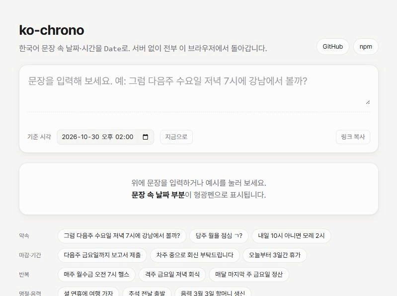

# ko-chrono &middot; [](https://www.npmjs.com/package/ko-chrono) [](https://github.com/jwn7/ko-chrono/actions/workflows/ci.yml) [](./LICENSE)

[한국어](./README.md) | English

`ko-chrono` finds dates and times in Korean sentences, like "다음주 화요일 오후 3시" (next Tuesday 3 PM), and turns them into `Date`. No runtime dependencies; works in the browser and Node.

[Try it in your browser](https://jwn7.github.io/ko-chrono/)



## Why

[chrono-node](https://github.com/wanasit/chrono) has no Korean locale, and a few regexes stop being enough pretty quickly:

- Does "3시에 보자" (see you at 3) mean 3 AM?
- On a Friday, is "다음주 월요일" (Monday next week) 3 days away or 10?
- "내가 낼게" (I'll pay) contains 낼, slang for tomorrow. "다음주 일정" (next week's schedule) contains 일, as in Sunday. Neither is a date.

ko-chrono picks an answer for each of these, writes it down in [SPEC.md](./SPEC.md) and pins it with tests. When it isn't sure, it returns `null` or tells you the other reading.

## Install

```bash
npm install ko-chrono
```

## Examples

All results assume the reference time 2026-10-30 (Fri) 14:00.

Find a meeting time in a chat message. `text` and `index` tell you where it was.

```ts
import { parse } from 'ko-chrono';

const r = parse('그럼 다음주 수요일 저녁 7시에 강남에서 볼까?'); // "Then shall we meet in Gangnam next Wed at 7 PM?"

r.date;  // 2026-11-04 19:00
r.text;  // '다음주 수요일 저녁 7시'
r.index; // 3
```

Split a to-do line into a title and a time. Deadlines ("까지" = by) go into `end`.

```ts
import { parseEvent } from 'ko-chrono';

parseEvent('다음주 금요일까지 보고서 제출'); // "Submit the report by next Friday"
// { title: '보고서 제출', end: 2026-11-06 23:59, hasTime: false, ... }

parseEvent('내일 오후 3시에 강남역에서 친구 만나기'); // "Meet a friend at Gangnam station tomorrow 3 PM"
// { title: '강남역에서 친구 만나기', date: 2026-10-31 15:00, hasTime: true }
```

Recurrences come out as an [RRULE](https://icalendar.org/iCalendar-RFC-5545/3-8-5-3-recurrence-rule.html), and `toICS` builds an `.ics` file.

```ts
import { parse, parseEvent, toICS } from 'ko-chrono';

parse('매주 월수금 오전 7시 운동')?.recurrence?.rrule;  // every Mon/Wed/Fri 7 AM → 'FREQ=WEEKLY;BYDAY=MO,WE,FR'
parse('매달 마지막 주 금요일 회식')?.recurrence?.rrule; // last Friday of every month → 'FREQ=MONTHLY;BYDAY=-1FR'
parse('다음달까지 매주 월요일 9시')?.recurrence?.rrule; // every Monday 9 AM until next month → '...;UNTIL=20261130T235900'

toICS(parseEvent('다음달까지 매주 월요일 9시 팀 회의'), { timezone: 'Asia/Seoul' });
// BEGIN:VCALENDAR ... SUMMARY:팀 회의 ... DTSTART;TZID=Asia/Seoul:20261102T090000 ...
```

When AM/PM is unclear, you get the default reading plus the alternative.

```ts
const r = parse('3시에 보자'); // "See you at 3"

r.date;      // today 15:00 (1-6 o'clock without AM/PM is read as PM)
r.ambiguity; // { reason: 'meridiem', alternatives: [tomorrow 03:00] }
```

If your server runs in UTC, pass `timezone`.

```ts
parse('내일 오후 3시', { timezone: 'Asia/Seoul' }); // 3 PM in Seoul
```

## What it understands

| Kind | Examples |
|---|---|
| Relative days | 오늘 (today), 내일 (tomorrow), 모레, 글피, 어제, 그저께, 낼 |
| N later / ago | 3일 뒤, 2주 전, 한 달 뒤, 한 시간 반 뒤, 30분 내로 |
| Weeks & weekdays | 다음주 화요일, 담주 월욜 (slang), 지난 금요일, 이번 주말, 11월 첫째 주 월요일 |
| Dates | 11월 5일, 2026-11-05, 11/5, 26.11.5, 11/3(화) |
| Months & years | 이번달 말, 다음달 중순, 내년 초, 연말, 내년 이맘때 |
| Times | 오후 3시, 3시 반, 15:30, 3pm, 정오, 자정, 점심, 퇴근 |
| Deadlines & ranges | \~까지, \~안에, 이번 주 안에, A부터 B까지, 3\~5시, 오늘부터 3일간 |
| Holidays | 크리스마스, 설 연휴, 추석 전날, 부처님 오신 날, 음력 3월 3일 (lunar) |
| Business words | 금일, 익일, 차주, 익월 초, 금월 말까지 |
| Recurrence | 매일, 매주 월수금, 격주, 매달 15일, 매달 마지막 주 금요일, 다음달까지, 총 8회 |

Phrases that aren't dates, like "3일 연속" (3 days in a row), "주 5일 근무" (5 days a week) or "내가 낼게" (I'll pay), return `null`. The full rule set is in [SPEC.md](./SPEC.md) (Korean).

## API

| Function | Returns |
|---|---|
| `parse(text, options?)` | The first `ParseResult`, or `null` |
| `parseAll(text, options?)` | Every `ParseResult` in the sentence |
| `parseDate(text, options?)` | `parse(...)?.date` |
| `parseEvent(text, options?)` | `{ title, date, end?, hasTime, recurrence? }` |
| `toICS(result, options?)` | An `.ics` string. Options: `title`, `timezone`, `durationMinutes` |

`ParseResult`

| Property | |
|---|---|
| `date` | The resolved time. Start of a range; the reference time for a deadline |
| `end` | End of a range, or the deadline |
| `text`, `index` | The matched part of the sentence and its position |
| `hasTime` | Whether a time of day was given. If `false`, `date` is at `defaultHour` |
| `recurrence` | Recurrence info, including `rrule` |
| `ambiguity` | `{ reason, alternatives }` when the reading is unclear. reason is `meridiem`, `next-weekday` or `approximate-time` |

Options

| Name | Default | |
|---|---|---|
| `referenceDate` | `new Date()` | What "tomorrow" and "next week" are relative to |
| `timezone` | runtime | IANA name such as `'Asia/Seoul'` |
| `weekStart` | `'monday'` | First day of the week |
| `defaultHour` | `0` | Hour used for dates without a time |

## Contributing

If a sentence isn't recognised or is read wrong, please [open an issue](https://github.com/jwn7/ko-chrono/issues/new?template=sentence.yml). Korean or English is fine; real sentences help the most.

## License

[MIT](./LICENSE)
