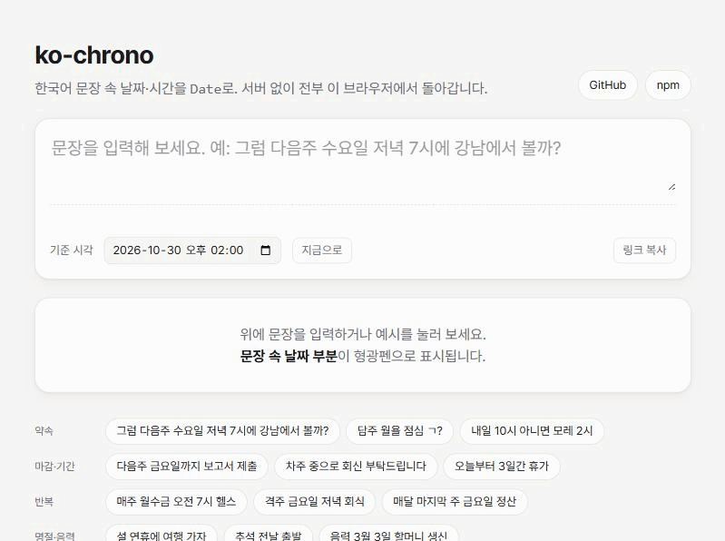

# ko-chrono &middot; [](https://www.npmjs.com/package/ko-chrono) [](https://github.com/jwn7/ko-chrono/actions/workflows/ci.yml) [](./LICENSE)

한국어 | [English](./README.en.md)

`ko-chrono`는 "다음주 화요일 오후 3시" 같은 한국어 문장에서 날짜와 시간을 찾아 `Date`로 바꿔 주는 JavaScript 라이브러리입니다. 런타임 의존성이 없고 브라우저와 Node에서 모두 쓸 수 있습니다.

[브라우저에서 바로 해 보기](https://jwn7.github.io/ko-chrono/)



## 왜 만들었나

영어라면 [chrono-node](https://github.com/wanasit/chrono)를 쓰면 되는데 한국어 로케일이 없습니다.
정규식 몇 줄이면 될 것 같지만 막상 짜 보면 금방 막힙니다.

- "3시에 보자"의 3시가 새벽 3시일까?
- 금요일에 "다음주 월요일"이라고 하면 3일 뒤일까, 10일 뒤일까?
- "내가 낼게"의 `낼`, "다음주 일정"의 `일`은 날짜가 아니다.

이런 경우를 하나씩 정해서 [SPEC.md](./SPEC.md)에 적어 두고 테스트로 고정했습니다. 확실하지 않으면 추측하지 않고 `null`을 돌려주거나 다른 해석을 같이 알려 줍니다.

## 설치

```bash
npm install ko-chrono
```

## 사용 예시

예시의 결과는 모두 2026-10-30(금) 14:00 기준입니다.

채팅 메시지에서 약속 시간 찾기. `text`, `index`로 메시지 안의 위치도 알 수 있습니다.

```ts
import { parse } from 'ko-chrono';

const r = parse('그럼 다음주 수요일 저녁 7시에 강남에서 볼까?');

r.date;  // 2026-11-04 19:00
r.text;  // '다음주 수요일 저녁 7시'
r.index; // 3
```

할 일 앱처럼 한 줄을 제목과 시간으로 나누기. "까지"가 붙으면 `end`에 들어갑니다.

```ts
import { parseEvent } from 'ko-chrono';

parseEvent('다음주 금요일까지 보고서 제출');
// { title: '보고서 제출', end: 2026-11-06 23:59, hasTime: false, ... }

parseEvent('내일 오후 3시에 강남역에서 친구 만나기');
// { title: '강남역에서 친구 만나기', date: 2026-10-31 15:00, hasTime: true }
```

반복 일정은 [RRULE](https://icalendar.org/iCalendar-RFC-5545/3-8-5-3-recurrence-rule.html)로 나옵니다. `toICS`로 캘린더 파일(.ics)도 만들 수 있습니다.

```ts
import { parse, parseEvent, toICS } from 'ko-chrono';

parse('매주 월수금 오전 7시 운동')?.recurrence?.rrule;  // 'FREQ=WEEKLY;BYDAY=MO,WE,FR'
parse('매달 마지막 주 금요일 회식')?.recurrence?.rrule; // 'FREQ=MONTHLY;BYDAY=-1FR'
parse('다음달까지 매주 월요일 9시')?.recurrence?.rrule; // 'FREQ=WEEKLY;BYDAY=MO;UNTIL=20261130T235900'
parse('매주 수요일 2시, 총 8회')?.recurrence?.rrule;   // 'FREQ=WEEKLY;BYDAY=WE;COUNT=8'

toICS(parseEvent('다음달까지 매주 월요일 9시 팀 회의'), { timezone: 'Asia/Seoul' });
// BEGIN:VCALENDAR ... SUMMARY:팀 회의 ... DTSTART;TZID=Asia/Seoul:20261102T090000 ...
```

"3시"처럼 오전인지 오후인지 모르는 경우엔 기본 해석과 함께 다른 후보를 줍니다.

```ts
const r = parse('3시에 보자');

r.date;      // 오늘 15:00
r.ambiguity; // { reason: 'meridiem', alternatives: [내일 03:00] }
```

서버가 UTC로 돌고 있다면 `timezone`을 넘기세요.

```ts
parse('내일 오후 3시', { timezone: 'Asia/Seoul' }); // 서울 기준 오후 3시
```

## 읽을 수 있는 표현

| 분류 | 예 |
|---|---|
| 상대 날짜 | 오늘, 내일, 모레, 글피, 어제, 그저께, 내일모레, 낼 |
| N 뒤/전 | 3일 뒤, 이틀 후, 2주 전, 한 달 뒤, 1년 뒤, 한 시간 반 뒤, 30분 내로 |
| 주·요일 | 다음주 화요일, 담주 월욜, 지난 금요일, 이번 주말, 다다음주, 11월 첫째 주 월요일 |
| 날짜 | 11월 5일, 2026-11-05, 11/5, 26.11.5, 11/3(화), 십일월 오일, 5일까지 |
| 월·연 | 이번달 말, 다음달 중순, 올해 말, 내년 초, 연말, 월초, 내년 이맘때 |
| 시각 | 오후 3시, 3시 반, 15:30, 3pm, 정오, 자정, 점심, 퇴근, 5시 10분 전 |
| 마감·구간 | \~까지, \~안에, \~중으로, 이번 주 안에, A부터 B까지, 3\~5시, 월\~금, 오늘부터 3일간, 이번 주 내내 |
| 명절·음력 | 크리스마스, 광복절 전날, 설날, 설 연휴, 추석, 부처님 오신 날, 음력 3월 3일 |
| 업무용 한자어 | 금일, 명일, 익일, 작일, 금주, 차주, 익월 초, 금월 말까지, 익년 |
| 반복 | 매일, 매주 월수금, 격주, 평일마다, 매달 15일, 매달 마지막 주 금요일, 매년 3월 1일 |
| 반복의 시작·끝 | 다음달까지 매주 월요일, 다음주부터 매일, 10주 동안, 총 8회 |

"3일 연속", "주 5일 근무", "24시 편의점", "내가 낼게"처럼 날짜가 아닌 말은 잡지 않습니다.

애매한 표현을 어떻게 읽는지는 몇 가지만 적으면 이렇습니다. 전체는 [SPEC.md](./SPEC.md)에 있습니다.

- 주는 월요일에 시작합니다. "다음주 월요일"은 다음 주의 월요일입니다. (`weekStart`로 바꿀 수 있음)
- 요일만 말하면 오늘을 포함해 가장 가까운 그 요일입니다. 금요일에 "금요일"은 오늘.
- 오전/오후 없는 1\~6시는 오후로 봅니다. 7\~12시는 그대로.
- 시각만 있으면 오늘, 이미 지났으면 내일입니다.
- 연도 없는 날짜가 이미 지났으면 내년입니다.
- "까지"가 붙으면 `date`는 지금, `end`는 마감입니다. 시각이 없으면 그날 23:59.
- 설날·추석 같은 음력 명절은 한국천문연구원 자료가 있는 2025\~2028년만 계산합니다.

## API

| 함수 | 반환 |
|---|---|
| `parse(text, options?)` | 처음 찾은 `ParseResult`, 없으면 `null` |
| `parseAll(text, options?)` | 찾은 `ParseResult` 전부 |
| `parseDate(text, options?)` | `parse(...)?.date` |
| `parseEvent(text, options?)` | `{ title, date, end?, hasTime, recurrence? }` |
| `toICS(result, options?)` | `.ics` 문자열. 옵션은 `title`, `timezone`, `durationMinutes` |

`ParseResult`

| 속성 | 설명 |
|---|---|
| `date` | 찾은 시점. 구간이면 시작, 마감이면 기준 시각 |
| `end` | 구간의 끝이나 마감 |
| `text`, `index` | 문장에서 찾은 부분과 그 위치 |
| `hasTime` | 시각까지 말했는지. `false`면 `date`는 `defaultHour`시 |
| `recurrence` | 반복 일정 정보 (`rrule` 포함) |
| `ambiguity` | 해석이 갈릴 때 `{ reason, alternatives }`. reason은 `meridiem`, `next-weekday`, `approximate-time` |

옵션

| 이름 | 기본값 | 설명 |
|---|---|---|
| `referenceDate` | `new Date()` | "내일", "다음주"의 기준 시각 |
| `timezone` | 실행 환경 | `'Asia/Seoul'` 같은 IANA 시간대 |
| `weekStart` | `'monday'` | 주의 시작 요일 |
| `defaultHour` | `0` | 시각이 없는 날짜에 넣을 시 |

## 예제

- [할 일 빠른 입력](./examples/quick-add.mjs): `node examples/quick-add.mjs "다음주 금요일까지 보고서 제출"`
- [Slack 봇](./examples/slack-bot): 메시지에서 날짜를 찾아 스레드에 알려 줌
- [Playground](https://jwn7.github.io/ko-chrono/): 로컬에서는 `npm run playground`

## LLM에 물어보면 되지 않나요?

됩니다. 다만 메신저 문장 112개로 비교해 보니 ko-chrono는 문장당 0.017ms, Gemini Flash-Lite(무료 티어)는 987ms가 걸렸고, LLM은 같은 문장에 다른 답을 낼 때도 있었습니다. ([결과](./bench/RESULTS.md))

보통 문장은 ko-chrono로 처리하고, `null`이 나오거나 `ambiguity`가 있는 문장만 LLM에 넘기는 식으로 같이 쓰는 걸 추천합니다.

## 기여하기

인식이 안 되거나 이상하게 읽히는 문장이 있으면 [이슈](https://github.com/jwn7/ko-chrono/issues/new?template=sentence.yml)로 알려 주세요. 실제로 쓰는 문장이 제일 도움이 됩니다.

```bash
npm install
npm test
```

## 라이선스

[MIT](./LICENSE)
