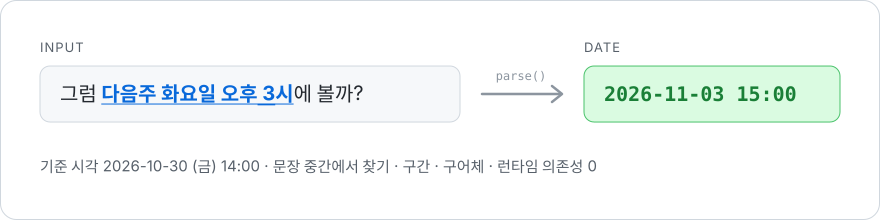

<div align="center">

# ko-chrono

**한국어 문장 속 날짜·시간을 `Date`로**

[](https://www.npmjs.com/package/ko-chrono)
[](https://github.com/jwn7/ko-chrono/actions/workflows/ci.yml)
[](./package.json)
[](./LICENSE)

<picture>
  <source media="(prefers-color-scheme: dark)" srcset="./docs/banner-dark.svg">
  
</picture>

[설치](#설치) · [사용법](#사용법) · [지원 표현](#지원-표현) · [해석 규칙](#해석-규칙) · [예제](#예제) · [문장 제보](https://github.com/jwn7/ko-chrono/issues/new?template=sentence.yml)

</div>

<br>

[chrono-node](https://github.com/wanasit/chrono)는 영어·일본어·중국어 등은 지원하지만 한국어는 없습니다.
[es-hangul](https://github.com/toss/es-hangul)이 **글자**를 다룬다면, ko-chrono는 **문장 속 시간**을 다룹니다.

| 입력 | 결과 <sub>(기준: 2026-10-30 금 14:00)</sub> |
|---|---|
| 그럼 **다음주 수요일 저녁 7시**에 강남에서 볼까? | `2026-11-04 19:00` |
| **이번 주 안에** 보내주세요 | 마감 `2026-11-01 23:59` |
| **오늘부터 3일간** 휴가 | `10-30` \~ `11-01 23:59` |
| **담주 월욜 점심** ㄱ? | `2026-11-02 12:00` |
| **11월 첫째 주 월요일**에 시작 | `2026-11-02` |
| **3시**에 보자 | `2026-10-30 15:00` |
| 내가 낼게 | `null` (날짜 아님) |

<br>

## 특징

- **문장 중간에서 찾기** — 앞뒤 말은 무시하고 날짜 부분만, 여러 개면 전부
- **구간과 마감** — "\~까지", "A부터 B까지", "3\~5시", "오늘부터 3일간", "이번 주 내내"
- **반복 일정** — "매주 월수금 7시", "격주 화요일", "매달 마지막 주 금요일" → 캘린더용 RRULE
- **공휴일·명절** — "크리스마스 이브", "설 연휴", "추석 전날" (음력은 한국천문연구원 자료 기준)
- **구어체** — "담주 월욜", "낼 오후 2시", "내일모레", "3시쯤", 띄어쓰기 생략
- **틀리느니 비운다** — "3일 연속", "2시간짜리", "1월생"은 날짜로 잡지 않음
- **서버에서도 정확** — `timezone: 'Asia/Seoul'` 한 줄이면 UTC 서버에서도 한국 시간
- **가볍다** — 런타임 의존성 0, ESM·CommonJS 둘 다, 브라우저·Node 모두

<br>

## 설치

```bash
npm install ko-chrono
```

## 사용법

```ts
import { parse, parseAll, parseDate } from 'ko-chrono';

parseDate('다음주 화요일 오후 3시');   // Date: 2026-11-03 15:00

parse('그럼 다음주 수요일 저녁 7시에 강남에서 볼까?');
// { date: 2026-11-04 19:00, text: '다음주 수요일 저녁 7시', index: 3, hasTime: true }

parse('이번달 말까지 제출');
// { date: 지금, end: 2026-10-31 23:59, text: '이번달 말까지', hasTime: false }

parseAll('내일 10시 아니면 모레 2시');
// [ { date: 10-31 10:00, ... }, { date: 11-01 14:00, ... } ]
```

### 할 일·일정 한 줄: `parseEvent`

할 일 앱이나 캘린더의 빠른 입력처럼, 한 줄을 **제목과 시점**으로 나눕니다.

```ts
import { parseEvent } from 'ko-chrono';

parseEvent('다음주 금요일까지 보고서 제출');
// { title: '보고서 제출', date: 지금, end: 2026-11-06 23:59, hasTime: false }

parseEvent('내일 오후 3시에 강남역에서 친구 만나기');
// { title: '강남역에서 친구 만나기', date: 2026-10-31 15:00, hasTime: true }

parseEvent('우유 사기');
// { title: '우유 사기', date: null, hasTime: false }
```

### 애매한 해석: `ambiguity`

"3시"가 오후인지 새벽인지처럼 해석이 갈릴 수 있으면, 기본 해석은 그대로 두고 다른 후보를 함께 알려 줍니다.
사용자에게 되묻거나, 이런 문장만 LLM에 넘길 때 쓰면 됩니다.

```ts
const r = parse('3시에 보자');
// r.date      → 오늘 15:00 (오전/오후가 없는 1~6시는 오후로)
// r.ambiguity → { reason: 'meridiem', alternatives: [내일 03:00] }

if (!r) askLLM(text);                                 // 날짜를 못 찾음
else if (r.ambiguity?.alternatives.length) confirm(r);  // "오후 3시 맞으세요?"
```

| `reason` | 언제 | `alternatives` |
|---|---|---|
| `meridiem` | 오전/오후 없는 1\~12시 ("3시", "내일 7시") | 반대쪽 12시간 |
| `next-weekday` | "다음 토요일"이 이번 주 토요일일 수도, 다음 주 토요일일 수도 | 다른 쪽 날짜 |
| `approximate-time` | "저녁"(19시), "아침"(8시)처럼 관례로 정한 시각 | 없음 |

### 반복 일정

`recurrence.rrule`은 [RFC 5545 RRULE](https://icalendar.org/iCalendar-RFC-5545/3-8-5-3-recurrence-rule.html)이라 Google·Apple 캘린더, iCal에 그대로 넣을 수 있습니다. `date`는 기준 시각 이후 첫 발생입니다.

```ts
parse('매주 월수금 오전 7시 운동');
// {
//   date: 2026-11-02 07:00,
//   text: '매주 월수금 오전 7시',
//   recurrence: { freq: 'WEEKLY', interval: 1, byWeekday: [1, 3, 5], rrule: 'FREQ=WEEKLY;BYDAY=MO,WE,FR' }
// }

parse('매달 마지막 주 금요일 회식')?.recurrence?.rrule;  // 'FREQ=MONTHLY;BYDAY=-1FR'
parse('격주 화요일')?.recurrence?.rrule;                 // 'FREQ=WEEKLY;INTERVAL=2;BYDAY=TU'
```

### API

| 함수 | 반환 |
|---|---|
| `parse(text, options?)` | 첫 번째 표현의 `ParseResult`, 없으면 `null` |
| `parseAll(text, options?)` | 모든 표현의 `ParseResult[]` |
| `parseDate(text, options?)` | `parse(...)?.date` 단축형 |
| `parseEvent(text, options?)` | `{ title, date, end?, hasTime, recurrence? }` — 날짜를 뺀 나머지가 제목 |

| `ParseResult` | |
|---|---|
| `date` | 찾은 시점. 구간이면 시작, 마감이면 기준 시각 |
| `end` | 구간의 끝 또는 마감. 없으면 `undefined` |
| `text` | 문장에서 찾은 부분 (`'다음주 수요일 저녁 7시'`) |
| `index` | 문장 안에서의 위치 |
| `hasTime` | 시각까지 말했는지. `false`면 `date`는 그날 `defaultHour`시 |
| `recurrence` | 반복 일정이면 규칙 (`freq`, `interval`, `byWeekday`, …, `rrule`) |
| `ambiguity` | 해석이 갈릴 수 있으면 `{ reason, alternatives }` |

### 옵션

| 옵션 | 기본값 | 설명 |
|---|---|---|
| `referenceDate` | `new Date()` | "내일", "다음주"의 기준 시각 |
| `timezone` | 실행 환경 | "오후 3시"를 어느 시간대의 3시로 볼지 (IANA 이름) |
| `weekStart` | `'monday'` | "이번주/다음주" 계산 기준 (`'sunday'` 가능) |
| `defaultHour` | `0` | 시각 없는 날짜에 넣을 시 |

> [!TIP]
> **서버에서는 `timezone`을 꼭 넘기세요.** Vercel, AWS Lambda 같은 서버는 보통 UTC로 돌아서, 그대로 쓰면 한국 사용자의 "오후 3시"가 한국 시간 자정이 됩니다.
> ```ts
> parse('내일 오후 3시', { timezone: 'Asia/Seoul' });  // 서버 시간대와 상관없이 서울 오후 3시
> ```
> 브라우저에서는 사용자의 시간대가 기본값이라 보통 필요 없습니다. 내장 `Intl`로 계산해서 의존성이 늘지 않습니다.

<br>

## 지원 표현

| 분류 | 예 |
|---|---|
| 상대 날짜 | 오늘 · 내일 · 모레 · 글피 · 어제 · 그저께 · 내일모레 · 낼 |
| N 뒤/전 | 3일 뒤 · 이틀 후 · 2주 전 · 한 달 뒤 · 1년 뒤 · 한 시간 반 뒤 · 30분 내로 |
| 주·요일 | 다음주 화요일 · 담주 월욜 · 지난 금요일 · 이번 주말 · 다다음주 |
| N째 주 | 11월 첫째 주 월요일 · 둘째 주 · 마지막 주 금요일 |
| 날짜 | 11월 5일 · 2026-11-05 · 11/5 · 26.11.5 · 11/3(화) · 십일월 오일 · 2027년 |
| 월·연 | 이번달 말 · 다음달 중순 · 올해 말 · 내년 초 · 연말 · 월초 · 내년 이맘때 |
| 시각 | 오후 3시 · 3시 반 · 15:30 · 3pm · 정오 · 자정 · 점심 · 퇴근 · 5시 10분 전 |
| 마감 | \~까지 · \~안에 · \~중으로 · 이번 주 안에 · 오전 중으로 · 퇴근 전까지 |
| 구간 | A부터 B까지 · 3\~5시 · 월\~금 · 오늘부터 3일간 · 3박 4일 · 이번 주 내내 |
| 공휴일·명절 | 크리스마스 · 빼빼로데이 · 광복절 전날 · 설날 · 설 연휴 · 추석 전날 · 부처님 오신 날 |
| 음력 | 음력 3월 3일 · 음력 윤5월 1일 · 2028년 음력 9월 9일 |
| 반복 | 매일 · 매주 월수금 · 매주 월\~금 · 격주 · 평일마다 · 매달 15일 · 매월 말일 · 매달 마지막 주 금요일 · 매년 3월 1일 · 2시간마다 |
| 문장 | 띄어쓰기 생략 · 조사(은·는·도) · 어림말(쯤·경·께) · 여러 개 추출 |

입력별 결과 전체는 [SPEC.md](./SPEC.md)에 있습니다. 인식 못 하는 문장이 있으면 [제보해 주세요](https://github.com/jwn7/ko-chrono/issues/new?template=sentence.yml).

<br>

## 해석 규칙

애매한 표현은 아래처럼 정해 두었습니다. 같은 문장은 언제나 같은 답을 냅니다.

<details>
<summary><b>규칙 전체 보기</b> (24개 중 주요 규칙)</summary>

<br>

**요일과 주**
- "다음주 월요일" = 기준일이 속한 주의 다음 주 월요일 (금요일에 말하면 3일 뒤)
- "월요일" 단독 = 오늘 포함 가장 가까운 미래의 월요일
- "지난 금요일" = 오늘 제외 가장 가까운 과거, "다음 금요일" = 오늘 제외 가장 가까운 미래
- "이번 주말" = 그 주의 토요일. "주말" 단독 = 다가오는 토요일 (토·일이면 오늘)
- "11월 첫째 주 월요일" = 11월의 첫 번째 월요일. 요일이 없으면 N번째 월요일

**시각**
- 오전/오후가 없는 1\~6시는 오후 ("3시에 보자" → 15:00). 7\~11시는 그대로
- 시각만 있으면 오늘, 이미 지났으면 내일. 날짜를 말했으면 지났어도 그대로 ("오늘 아침" → 오늘 08:00)
- "오후 12시" = 정오. "내일 자정" · "내일 24시" · "내일 밤 12시" = 내일이 끝나는 시점 (모레 00:00)
- 시 범위의 끝은 시작의 오전·오후를 이어받음: "오후 3\~5시" → 15\~17시

**날짜**
- 월일만 있고 이미 지났으면 내년. "올해 3월 1일"처럼 연도를 말하면 그대로
- "3월", "2월 말"도 그 달이 다 지났으면 내년
- 두 자리 연도: 00\~69 → 20xx, 70\~99 → 19xx
- "내년 이맘때", "1년 뒤"는 오늘의 월·일 유지 (2/29 + 1년 → 2/28)

**구간·마감**
- "\~까지", "\~안에" → `date`는 기준 시각, `end`는 마감 (시각이 없으면 23:59)
- "이번 주 안에", "이번달 안에"는 그 기간의 마지막 날. "이번 주 내내"는 시작\~끝 구간
- "오늘부터 3일간" → `end`는 3일째 되는 날 23:59

**명절**
- "음력 3월 3일"처럼 음력이라고 말한 날짜도 같은 자료로 변환합니다
- 설날·추석·부처님 오신 날은 [한국천문연구원](https://astro.kasi.re.kr/life/post/calendarData) 자료가 있는 연도(현재 2025\~2028)만. 그 뒤는 추측하지 않고 `null`
- "설 연휴", "추석 연휴" = 전날부터 다음날까지 3일

**잡지 않는 것**
- 없는 날짜 (2월 30일, 11월 31일), 날짜와 요일이 안 맞는 경우 ("11월 5일 수요일")
- 기간만 있는 표현 ("3일간", "3박 4일"), 날짜가 아닌 말 ("3일 연속", "1월생", "내가 낼게")
- "내일 30분 후"처럼 날짜와 상대 시간이 섞이면 두 개의 결과로 나눔

</details>

<br>

## 예제

| | 예제 | 실행 |
|---|---|---|
| ✅ | [**할 일 빠른 입력**](./examples/quick-add.mjs)<br>`parseEvent`로 "다음주 금요일까지 보고서 제출" → 제목 "보고서 제출" + 마감 11/6 23:59 | `node examples/quick-add.mjs "..."` |
| 💬 | [**Slack 봇**](./examples/slack-bot)<br>채널 메시지에서 날짜를 찾아 스레드로 알려줌 (UTC 서버 + `timezone`) | `node examples/slack-bot/try.mjs` |
| 🧪 | [**Playground**](./playground/index.html)<br>브라우저에서 직접 입력해 보기 | `npm run playground` |

<br>

## LLM 대신 쓰는 이유

날짜를 LLM에 물어볼 수도 있지만, 정해진 규칙으로 풀리는 문제라면 이쪽이 빠르고 공짜이고 매번 같은 답을 냅니다.

메신저 문장 112개로 측정한 결과 ([자세히](./bench/RESULTS.md), Gemini Flash-Lite **무료 티어**, 2026-10-31):

| | ko-chrono | LLM API (Gemini Flash-Lite) |
|---|---|---|
| 지연 | 문장당 **0.017ms** | 문장당 **987ms** (네트워크만 40ms 이상) |
| 비용 | **0** | 토큰당 과금 (무료 티어는 분당·일일 한도) |
| 같은 문장 → 같은 답 | **항상** | 보장 안 됨 |
| 오프라인 · 브라우저 | **됨** | 안 됨 |
| 시제·문맥 ("깨서 못 잤어") | 모름 | 앎 |
| 처음 보는 표현 | 못 함 (`null`) | 대체로 함 |

유료 티어나 다른 모델이면 LLM 쪽이 더 빠를 수 있지만, 네트워크 왕복만으로도 ko-chrono보다 수천 배 느립니다. 정확도는 비슷한 수준이고 차이의 절반은 "저녁이 몇 시냐" 같은 관례 차이였습니다. 규칙으로 풀리는 날짜는 ko-chrono로, `null`이 나오거나 `ambiguity`가 있는 문장만 LLM으로 보내는 조합을 권합니다.

<br>

## 로드맵

- [x] 반복 일정 (매주 월요일 9시, 격주) → RRULE
- [x] 제목 분리 (`parseEvent`)
- [x] 명절·공휴일 (설 연휴, 추석 전날, 크리스마스) — 음력 명절은 한국천문연구원 자료가 있는 2025\~2028년
- [x] 일반 음력 날짜 (음력 3월 3일) — 한국천문연구원 자료가 있는 2025\~2028년
- [x] 모호성 정보 (`ambiguity`)
- [ ] chrono-node `ko` 로케일 기여 — 첫 PR 분량 준비됨 ([contrib/chrono-ko](./contrib/chrono-ko))

## 기여

가장 큰 도움은 **실제로 쓰이는 문장**입니다. 인식이 안 되거나 다르게 해석되는 문장을 [이슈로 제보](https://github.com/jwn7/ko-chrono/issues/new?template=sentence.yml)해 주세요.

```bash
npm install
npm test
npm run build
```

## 라이선스

[MIT](./LICENSE)
